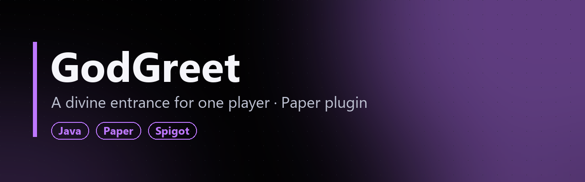
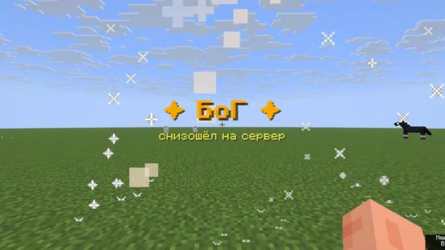
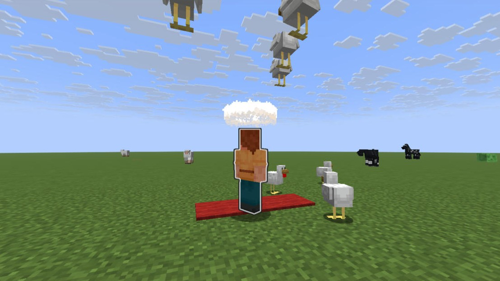

**[Русский](#русский) · [English](#english)**

> 🔒 Исходный код закрыт. В репозитории только описание плагина.
> 🔒 Source code is private. This repo contains a showcase only.

### Скриншоты с тестового сервера / Test server screenshots
| | |
|---|---|
|  |  |

_Paper 26.1.2: титр явления, боссбар, нимб, свечение и красная дорожка / arrival title, boss bar, halo, glow and red carpet._

---

## Русский

**GodGreet** — плагин для Paper/Spigot (Minecraft 26.1.2). Когда на сервер заходит выбранный игрок, начинается «явление БоГа».

### При заходе
- **Своё сообщение о входе** и ковровая дорожка, которая стелется под ногами.
- **Хор в чате.** Каждый игрок онлайн по очереди «пишет» `Здравствуй БоГ!`, и это выглядит как обычные реплики.
- **Музыка.** Пластинка плюс фанфара, собранная из нотных блоков по нотам. Мелодию можно задать в конфиге.
- **Поклон.** Все поворачиваются лицом к БоГу, плавно опускают голову и приседают. Анимация собрана из поворота головы и приседания, потому что API эмоций в игре нет.
- **Спецэффекты.** Титры на весь экран, кольцо безвредных молний, салют, столп частиц до неба, короткая «слепота от сияния» и благословение регенерацией.
- **Мир подчиняется.** Гроза прекращается, наступает полдень, враждебные мобы разбегаются.

### Пока БоГ онлайн
Фиолетовый боссбар у всех, свечение сквозь стены, золотой ник в Tab, префикс `✞` в чате, кольцо частиц над головой.

### Аккуратность
- **Дорожка не портит мир.** Блоки ставятся только на воздух, исходное состояние запоминается и возвращается.
- **Безопасные эффекты.** Молнии без урона и пожаров, свои фейерверки не бьют игроков.
- **Гибкий конфиг.** Каждая часть шоу включается и выключается отдельно, есть права `godgreet.admin` и `godgreet.exempt`.

**Команды:** `/gg`, `/gg test [ник]`, `/gg reload`, `/gg stop`, `/gg stopmusic`.

---

## English

**GodGreet** is a Paper/Spigot plugin for Minecraft 26.1.2. When a chosen player joins, the whole server stages a "divine arrival".

### On join
- **A custom join message** and a red carpet that rolls out under their feet.
- **A chat choir.** Every online player takes a turn "saying" `Hail, God!`, and it reads like normal chat.
- **Music.** A music disc plus a fanfare played on note blocks. The melody is configurable.
- **A bow.** Everyone turns to face the player, lowers their head smoothly and crouches. The animation is built from head pitch and sneaking, since the game has no emote API.
- **Spectacle.** Full-screen titles, a ring of harmless lightning, fireworks, a particle pillar to the sky, a brief "blinded by radiance" flash and a regeneration blessing.
- **The world obeys.** Storms stop, time jumps to noon, hostile mobs flee.

### While the player is online
A purple boss bar for everyone, a glow through walls, a golden name in Tab, a `✞` chat prefix, and a rotating particle halo.

### Safety
- **The carpet never damages the world.** Blocks are placed only in air, and the original blocks are recorded and restored.
- **Harmless effects.** Lightning deals no damage and starts no fires, and the plugin's own fireworks don't hurt players.
- **A flexible config.** Every part of the show can be toggled separately, with the permissions `godgreet.admin` and `godgreet.exempt`.

**Commands:** `/gg`, `/gg test [player]`, `/gg reload`, `/gg stop`, `/gg stopmusic`.
